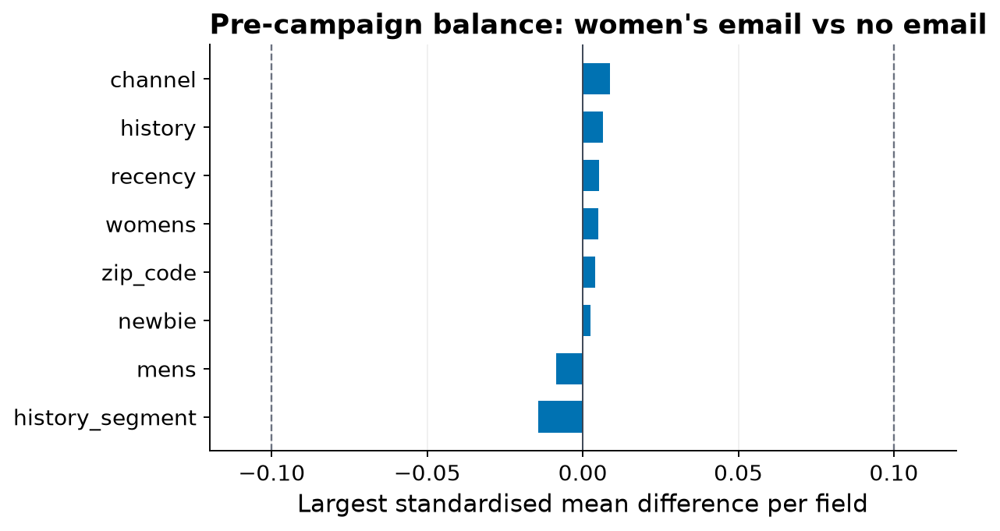
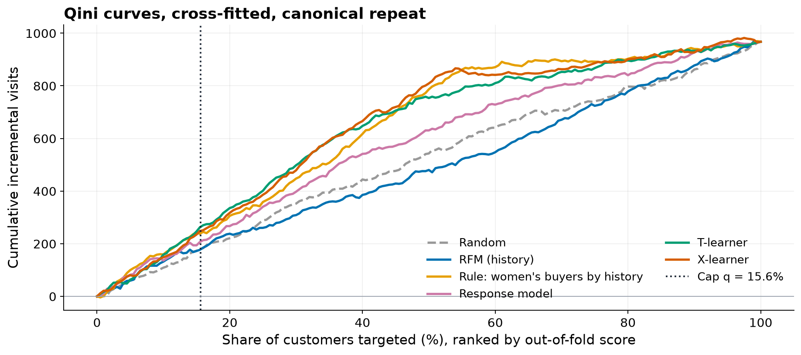
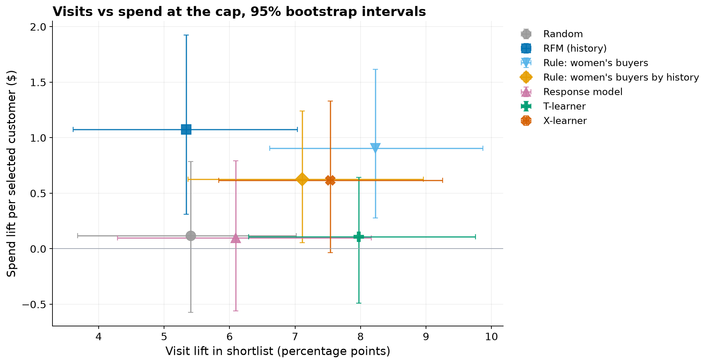
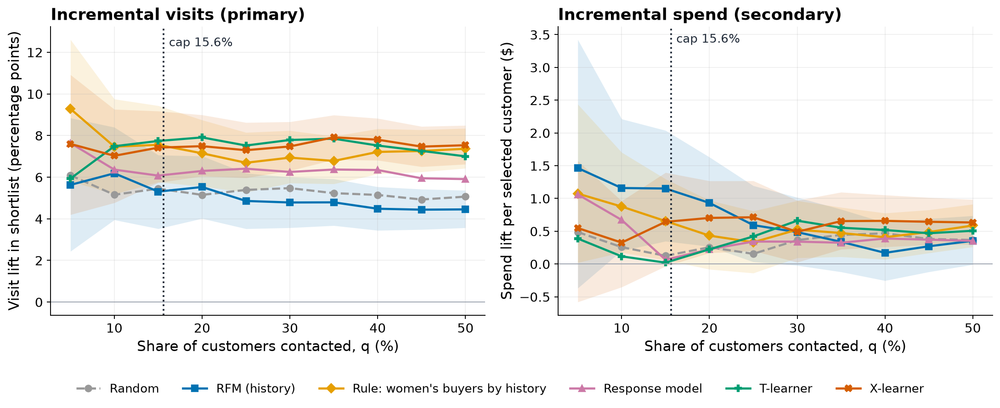
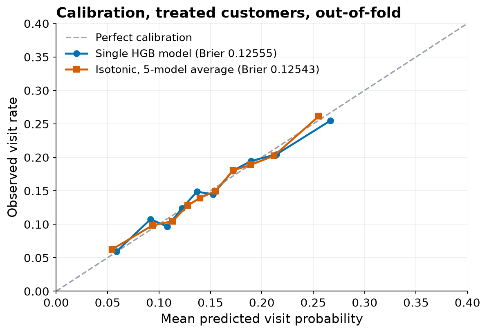
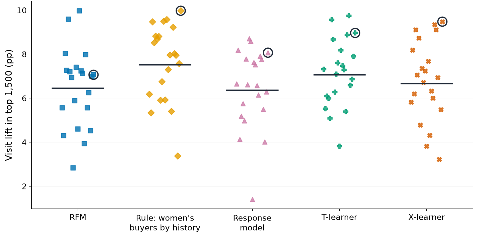
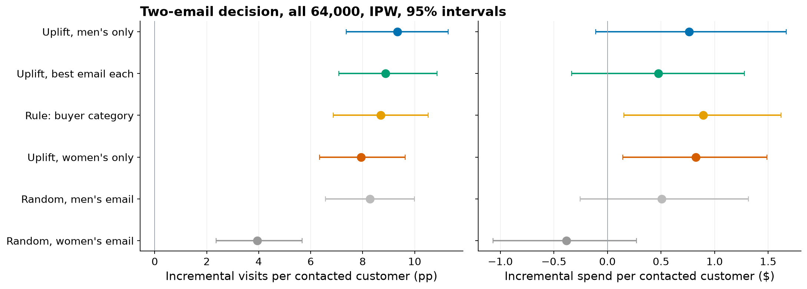

# Who Should Get the Women's Email?
### A complete, from-zero explainer of our Prospect Selection project

> **Who this is for.** Anyone who has never heard of this dataset, this problem, or uplift modelling, and who needs to understand the project well enough to present it and answer questions on it.
>
> **How to read it.** Parts 1 to 3 are the basics (no maths). Parts 4 to 6 explain the methods. Parts 7 to 10 explain the results and every graph. Parts 11 to 13 cover limits, the course brief and how to present. A glossary is at the end. If a word is unfamiliar, check the glossary.

---

## Contents

**Part 1 · The basics**
1. [The one-minute story](#1-the-one-minute-story)
2. [The general problem: too many options, too little capacity](#2-the-general-problem-too-many-options-too-little-capacity)
3. [Our setting: a retailer and an email](#3-our-setting-a-retailer-and-an-email)

**Part 2 · The data**
4. [The dataset, from scratch](#4-the-dataset-from-scratch)
5. [Why a random experiment is so valuable](#5-why-a-random-experiment-is-so-valuable)
6. [Checking that the experiment was fair (Graph 1)](#6-checking-that-the-experiment-was-fair-graph-1)

**Part 3 · The key idea**
7. [Response vs uplift: the single most important idea](#7-response-vs-uplift-the-single-most-important-idea)
8. [The exact decision we study](#8-the-exact-decision-we-study)

**Part 4 · The seven ways of choosing**
9. [The policies, one by one](#9-the-policies-one-by-one)
10. [The machine-learning models, explained slowly](#10-the-machine-learning-models-explained-slowly)

**Part 5 · How we tested them**
11. [The danger: grading your own homework](#11-the-danger-grading-your-own-homework)
12. [Cross-fitting: every customer scored by a model that never saw them](#12-cross-fitting-every-customer-scored-by-a-model-that-never-saw-them)
13. [How a list is scored: "lift"](#13-how-a-list-is-scored-lift)
14. [How sure are we? Intervals, bootstrap and paired comparisons](#14-how-sure-are-we-intervals-bootstrap-and-paired-comparisons)

**Part 6 · Results**
15. [The main results table](#15-the-main-results-table)
16. [Are the differences real? Paired comparisons](#16-are-the-differences-real-paired-comparisons)
17. [Graph 2: The Qini curve](#17-graph-2-the-qini-curve)
18. [Graph 3: Visits vs spend](#18-graph-3-visits-vs-spend)
19. [Who is on each list, and how much do lists overlap?](#19-who-is-on-each-list-and-how-much-do-lists-overlap)
20. [Money: break-even cost per email](#20-money-break-even-cost-per-email)

**Part 7 · Robustness checks**
21. [Graph 4: Does the answer change if the cap changes?](#21-graph-4-does-the-answer-change-if-the-cap-changes)
22. [Graph 5: Calibration, are the probabilities honest?](#22-graph-5-calibration-are-the-probabilities-honest)
23. [Graph 6: Why one train/test split is not enough](#23-graph-6-why-one-traintest-split-is-not-enough)
24. [How much data would settle "model vs rule"?](#24-how-much-data-would-settle-model-vs-rule)
25. [How much do the features explain at all?](#25-how-much-do-the-features-explain-at-all)

**Part 8 · Extension**
26. [Graph 7: What if we could send either email?](#26-graph-7-what-if-we-could-send-either-email)

**Part 9 · Honesty and the brief**
27. [What we cannot claim](#27-what-we-cannot-claim)
28. [How the project answers the course brief](#28-how-the-project-answers-the-course-brief)

**Part 10 · Presenting**
29. [A 12-minute presentation plan](#29-a-12-minute-presentation-plan)
30. [Questions you may be asked, with answers](#30-questions-you-may-be-asked-with-answers)
31. [Glossary](#31-glossary)
32. [Files and how to rerun](#32-files-and-how-to-rerun)

---

# Part 1 · The basics

## 1. The one-minute story

An online clothing retailer wants to send a **women's-merchandise email**. Company policy says it can email **at most 15.6% of its customers** in one campaign. So it must **choose** who gets the email.

We had real data from an experiment where this retailer sent the email to **randomly chosen** customers and recorded what happened over the next two weeks. That randomness lets us fairly test **any** way of choosing customers.

We tested **seven ways of choosing** (we call them *policies*): random picking, the classic "biggest past spenders first" rule (RFM), two very simple rules based on whether the customer bought women's clothes before, and three machine-learning models.

**What we found, in five sentences:**

1. **The uplift models beat the classic "big spenders first" rule on extra website visits.** The X-learner model got +2.2 percentage points more extra visits than RFM, and that gap is clearly real.
2. **A one-line rule did just as well as the models.** "Email past women's buyers first, biggest spenders among them first" matched the best models. We cannot tell them apart.
3. **"Big spenders first" (RFM) is no better than random at creating extra visits**, but it does lead on extra spending, with a lot of uncertainty.
4. **Spending is very hard to measure**, because 99.3% of customers spent nothing in the two weeks.
5. **If the retailer could also send a men's email, the choice of email matters as much as the choice of customers.**

The honest headline: **machine learning was useful compared with the standard industry rule, but a simple, transparent rule that a manager could write on a sticky note did just as well.**

---

## 2. The general problem: too many options, too little capacity

Our course brief describes a common business situation:

> *An organisation has more opportunities than it can pursue, and which ones it chooses matters.*

Examples:
- An investment bank can arrange only 50 investor meetings before a company goes public. Which 50 investors?
- A supplier cannot write proposals for every contract. Which contracts?
- A retailer cannot (or should not) email every customer. Which customers?

In every case there is:
- **An organisation** making the choice.
- **Opportunities** to choose among.
- **A limit, K**, on how many can be pursued.
- **A goal**: what a good choice achieves.
- **A ranking**: put the opportunities in order and take the top K.

The hard part is not building the ranking. It is **proving that the ranking is good**, using real outcomes, and comparing it with a sensible simple alternative.

---

## 3. Our setting: a retailer and an email

| Brief's term | Our project |
|---|---|
| Organisation | An online apparel (clothing) retailer |
| Opportunities | Its customers, each of whom could receive the email |
| Limit K | At most **q = 15.6%** of customers can be emailed in one campaign |
| What "good" means | **Primary:** as many *extra* website visits caused by the email as possible. **Secondary:** extra spending caused by the email |
| Ranking | Each policy gives every customer a score. The top 15.6% by score get the email |

**Why would a retailer limit emails at all, if email is cheap?** Because every email has hidden costs: customers get annoyed, unsubscribe, or mark emails as spam, which hurts future campaigns. Many companies have a "contact policy" that limits how often and how many customers they email. Our data does not measure these hidden costs, so we treat the cap as a **business rule we are given**, not something we derive.

**Why 15.6%?** The dataset's author (Kevin Hillstrom) posed a challenge question with this data: *"Which 10,000 customers should get the email?"* 10,000 out of 64,000 customers is 15.6%. We took this external, real number rather than inventing one. We also check other caps from 5% to 50% (Section 21) to show the conclusions do not depend on this exact number.

---

# Part 2 · The data

## 4. The dataset, from scratch

**Source.** Kevin Hillstrom, *MineThatData E-Mail Analytics and Data Mining Challenge*, 2008. It is public and free:
`http://www.minethatdata.com/Kevin_Hillstrom_MineThatData_E-MailAnalytics_DataMiningChallenge_2008.03.20.csv`

**What one row is.** One row = **one customer** who bought something from the retailer in the past 12 months. There are **64,000 rows**.

**What happened.** Each customer was put **at random** into one of three groups (called *arms*):

| Arm | What they got | Share |
|---|---|---|
| No E-Mail | Nothing (the "control" group) | 33.3% |
| Womens E-Mail | An email featuring women's merchandise | 33.4% |
| Mens E-Mail | An email featuring men's merchandise | 33.3% |

Then the retailer recorded what each customer did in the **next two weeks**.

**The columns.** Some describe the customer **before** the email. Others record what happened **after**.

| Column | Meaning | Known before the email? | How we use it |
|---|---|---|---|
| `recency` | Months since the customer's last purchase | Yes | Feature |
| `history` | Dollars spent in the past 12 months | Yes | Feature |
| `history_segment` | Spending band, e.g. "$100 to $200" | Yes | Feature |
| `mens` | Bought men's items in the past year (1 = yes) | Yes | Feature |
| `womens` | Bought women's items in the past year (1 = yes) | Yes | Feature |
| `newbie` | New customer in the past 12 months (1 = yes) | Yes | Feature |
| `zip_code` | Urban, Suburban or Rural | Yes | Feature |
| `channel` | Bought by Phone, Web, or both ("Multichannel") | Yes | Feature |
| `segment` | Which arm the customer was randomly put in | Assigned by the experiment | Treatment |
| `visit` | Visited the website in the two weeks (1 = yes) | No, it is an outcome | **Primary outcome** |
| `conversion` | Bought something in the two weeks | No, it is an outcome | Not used |
| `spend` | Dollars spent in the two weeks | No, it is an outcome | **Secondary outcome** |

**Important rule we follow:** our policies only ever use the **eight "before" columns** (the *features*). They never see what happened after. This matters because when a real retailer decides who to email, it does not yet know who will visit.

**Which customers we use.** The main analysis is about the women's email. So we use the **Womens E-Mail** arm (people who got the email, called *treated* or *emailed*) and the **No E-Mail** arm (people who did not, called *control*). That is **42,693 customers: 21,387 emailed and 21,306 not emailed**. (The men's arm is used only in the extension in Section 26.)

**Basic facts in the raw data:**

| | No E-Mail | Womens E-Mail | Difference |
|---|---|---|---|
| Visited the website | 10.6% | 15.1% | **+4.52 percentage points** |
| Average spend per customer | $0.65 | $1.08 | **+$0.42** |

- **99.3% of customers spent nothing at all.** The largest single spend was $499. This makes spending very "noisy": a few big buyers can swing an average.
- **Visits are about 18 times as common as purchases.** That is why we use visits as the main outcome: there is enough signal to measure differences.

---

## 5. Why a random experiment is so valuable

Here is the fundamental difficulty of measuring the effect of an email:

> We can never see the **same person** both emailed and not emailed.

If Priya got the email and visited, we do not know whether she would have visited anyway.

**Randomness solves this for groups.** Because the email was given out at random, the emailed and not-emailed groups are alike in every way except the email, apart from small chance differences. So:

> **Visit rate of the emailed group − visit rate of the not-emailed group = the effect of the email.**

And here is the trick that makes our whole project possible:

> Take **any list** of customers chosen using only the "before" columns. Inside that list, about half were emailed and half were not, by chance. So inside the list, we can again compare emailed vs not emailed. That tells us **the effect of the email on that list**.

This means we can **score any policy's list using real, observed outcomes**, without guessing or inventing a "right answer". The course brief specifically forbids inventing ground truth. A random experiment is the cleanest way to avoid it.

---

## 6. Checking that the experiment was fair (Graph 1)

If the randomisation worked, the emailed and not-emailed groups should look alike **before** the email. We check this for every feature.

**The measure: SMD (standardised mean difference).**

> SMD = (average in emailed group − average in not-emailed group) ÷ (pooled standard deviation)

In words: how different are the two groups, measured in "units of natural spread"? It lets you compare features on different scales (dollars, months, yes/no). The usual rule of thumb: **SMD below 0.10 means the groups are well balanced.**



**How to read Graph 1.**
- Each bar is one of the eight features. For categorical features (like `channel`), we show the category with the biggest difference.
- The bar's length is the SMD. Right of zero means slightly higher in the emailed group; left means slightly lower.
- The dashed lines at −0.10 and +0.10 are the "worry" thresholds.

**What it tells us.** Every bar is tiny and far inside the dashed lines. The largest is 0.014, for `history_segment`. **All 8 of 8 features pass.** The randomisation worked, so comparing emailed vs not emailed is fair.

---

# Part 3 · The key idea

## 7. Response vs uplift: the single most important idea

There are two very different questions you could ask when choosing who to email:

1. **Response:** *Who is most likely to visit if I email them?*
2. **Uplift:** *Whose behaviour does the email change the most?*

They sound similar but give different answers. An example with two imaginary customers (illustrative numbers):

| Customer | Chance of visiting **if emailed** | Chance of visiting **if not emailed** | **Effect of the email** |
|---|---|---|---|
| A, a loyal regular | 90% | 85% | +5 percentage points |
| B, an occasional buyer | 40% | 20% | **+20 percentage points** |

- A **response** approach picks **A** (90% beats 40%).
- An **uplift** approach picks **B** (+20 beats +5).

**With a limited number of emails, B is the better use of one.** Customer A would mostly visit anyway; the email is partly wasted on them. Customer B visits much more because of the email.

This is why the **goal** in our project is *extra* visits **caused** by the email, not total visits. And it is why we test both response-style and uplift-style policies: to see if the difference matters in real data.

> **Uplift** is also called the **treatment effect**. For one type of customer, it is the **CATE** (conditional average treatment effect): the average effect of the email for customers who share given features.

---

## 8. The exact decision we study

- **Customers:** 42,693 (women's email arm + no-email arm).
- **Cap:** q = 15.6%, so **K = 6,670 customers** get selected by each policy.
- **Goal (primary):** maximise the **visit lift** in the selected list: the extra visit rate caused by the email.
- **Goal (secondary):** maximise the **spend lift**: extra dollars per customer caused by the email.
- **What a policy is allowed to know:** the eight pre-email features only.

**Why visits first, spend second?** The retailer probably cares most about money. But spending is almost always zero (99.3%), so differences in spend between policies are very hard to measure reliably. Visits are about 18 times more common, so we can measure them much better. Visits are a **leading indicator**: people must visit before they can buy. We report both, and we are open about the gap between "visit" and "what the business truly values" (see Section 27).

---

# Part 4 · The seven ways of choosing

## 9. The policies, one by one

Every policy does the same thing: give each customer a score, then email the top 15.6%. They differ only in **how they score**. All use the same eight features.

| # | Policy | Type | How it scores customers | Why it is here |
|---|---|---|---|---|
| 1 | **Random** | Floor | Random number (fixed seed so it can be repeated) | The minimum bar. Anything useful must beat this. |
| 2 | **RFM (history)** | Simple rule | Highest past 12-month spend first | The classic marketing rule. Our **main baseline**. |
| 3 | **Rule: women's buyers** | Simple rule | Past women's buyers first, random order among them | Tests whether one yes/no flag does the work. |
| 4 | **Rule: women's buyers by history** | Simple rule | Past women's buyers first, then by past spend | **Our main simple rule.** Fully transparent. |
| 5 | **Response model** | ML model | Predicts chance of visiting **if emailed** | Shows the response vs uplift difference. |
| 6 | **T-learner** | ML uplift model | Predicted visit chance if emailed − predicted if not emailed | The simplest uplift model. |
| 7 | **X-learner** | ML uplift model | A more refined uplift estimate (explained below) | Our most advanced uplift model. |
| (appendix) | **Calibrated EV** | ML model | Calibrated chance of visiting if emailed × log(1 + past spend) | Mixes response with spend size. Kept as a side policy. |

**About "RFM".** RFM stands for Recency, Frequency, Monetary value, a standard way marketers rank customers. Our data has no frequency column, so we use the **monetary** part: past 12-month spend (`history`). It is the rule most retailers would use without any data science.

**Why the women's-buyer rules?** It is a women's-merchandise email. The obvious, common-sense guess is "send it to people who bought women's clothes before." If a model cannot beat this obvious rule, the model adds little. The course brief asks exactly this: *"Could a simple rule achieve much of your result?"* We also saw that the uplift models' lists were almost all past women's buyers (99.5% of the X-learner's list), so this rule is the fairest test of what the models add.

**Ties.** Rules give many customers the same score (for example, all women's buyers with the same spend). We break ties with a seeded random number, so results are fair and repeatable.

---

## 10. The machine-learning models, explained slowly

### 10.1 The building block: a decision tree

A **decision tree** is a flowchart of yes/no questions that ends in a prediction:

```
Is womens = 1?
 ├─ yes → Is recency ≤ 3 months?
 │         ├─ yes → predicted visit chance 22%
 │         └─ no  → predicted visit chance 15%
 └─ no  → predicted visit chance 9%
```

The computer picks the questions that best separate visitors from non-visitors in the training data.

### 10.2 Gradient boosting (HGB)

One tree is crude. **Gradient boosting** builds **many small trees in sequence**. Each new tree focuses on correcting the mistakes of the trees before it. The final prediction adds them all up. It is one of the most reliable methods for tabular data like ours.

We use scikit-learn's **HistGradientBoosting (HGB)**. "Hist" means it groups feature values into bins first, which makes it fast.

| Model | Number of trees | Max leaves per tree | Learning rate | L2 penalty |
|---|---|---|---|---|
| Classifier (predicts visit yes/no) | 120 | 15 | 0.07 | 1.0 |
| Regressor (predicts effect size, X-learner only) | 100 | 10 | 0.05 | 2.0 |

- **Max leaves:** how many end points each tree can have. Smaller = simpler trees.
- **Learning rate:** how much each new tree is allowed to change the answer. Smaller = more cautious.
- **L2 penalty:** discourages extreme predictions. Bigger = more cautious.

**We did not tune these settings.** Tuning means trying many settings and keeping the one that scores best. If you tune on the same data you evaluate on, your model looks better than it really is. We fixed the settings in advance and never changed them based on results.

### 10.3 The response model

Train one HGB classifier on **emailed customers only**, predicting `visit`. Its score for any customer is: *"If we email this person, how likely are they to visit?"*

It answers the **response** question from Section 7. It will favour people like customer A, who visit a lot anyway.

### 10.4 The T-learner ("two models")

The simplest uplift model:

1. Train model **m1** on **emailed** customers: predicts visit chance *if emailed*.
2. Train model **m0** on **not-emailed** customers: predicts visit chance *if not emailed*.
3. For every customer: **uplift score = m1(customer) − m0(customer)**.

"T" stands for "two". It directly estimates the difference in Section 7's table.

**Weakness:** each model makes its own errors, and subtracting two noisy numbers gives an even noisier number.

### 10.5 The X-learner (a refined uplift model)

The X-learner tries to reduce that noise. Step by step:

1. **Fit the two visit models**, m1 (emailed) and m0 (not emailed), as in the T-learner. Here both are also **calibrated** (Section 10.7) using 5 internal folds.
2. **For each emailed customer**, estimate their personal effect:
   *actual visit (0 or 1) − m0(customer)*.
   We know what they did when emailed; we fill in "what if not emailed" with the other group's model.
3. **For each not-emailed customer**, do the mirror image:
   *m1(customer) − actual visit*.
4. **Fit two regression models** (HGB regressors) to these personal effects: **tau1** learns from the emailed group's effects, **tau0** from the not-emailed group's.
5. **Blend them:** score = e × tau0(customer) + (1 − e) × tau1(customer), where **e** is the share of customers who were emailed (about one half).

Why it can help: step 2 uses *real* outcomes for half of each estimate instead of two predictions, and step 4 smooths the noisy personal effects into a pattern. The name "X" comes from the criss-cross: each group's effects use the *other* group's model.

### 10.6 Calibrated EV (appendix policy)

Score = calibrated P(visit if emailed) × log(1 + past spend). It is a response model weighted towards bigger spenders. The `log` stops very large spenders from dominating completely. We keep it as a side comparison.

### 10.7 What "calibration" means

A model's probabilities are **calibrated** if, among all customers it says have a 20% chance of visiting, about 20% actually visit. **Isotonic calibration** is a correction step that bends the model's probabilities to match observed rates.

Key point for presenting: **calibration never changes a single model's ranking.** It is a "monotone" adjustment: if A's score was higher than B's before, it is still higher after. So calibration makes probabilities more trustworthy, but it does **not** change who gets picked. We check calibration in Section 22.

---

# Part 5 · How we tested them

## 11. The danger: grading your own homework

If you train a model on some customers and then test it on **the same customers**, it will look great, because it has partly memorised them. This is called **overfitting**, and testing that way is like a student grading their own homework.

The course brief demands: *"Evaluate your ranking using evidence not used to fit or choose your method."* So every customer must be scored by a model that **never saw that customer during training**.

The simplest way is to split the data once: train on 70%, test on 30%. We found that this is **not reliable enough here** (Section 23 shows why). So we use **cross-fitting**.

---

## 12. Cross-fitting: every customer scored by a model that never saw them

**Step by step:**

1. **Split** the 42,693 customers into **5 equal parts** (*folds*). The split is **stratified**: every fold has the same mix of emailed/not emailed and visited/not visited. This just keeps the folds comparable. `visit` is never used as a feature or for ranking.
2. **For each fold in turn:** train every model on the **other 4 folds**, then score the customers in **this** fold.
3. Now **every customer** has a score from models that never saw them. This is called an **out-of-fold** score.
4. **Inside each fold**, rank customers by score and take the **top 15.6%**. (We rank within each fold because models trained on different data can produce scores on slightly different scales.)
5. **Combine** the five fold lists into one list of **6,670 customers** per policy.
6. **Repeat** steps 1 to 5 with **5 different random fold splits** (fold seeds 0 to 4) to see how much results move when models are retrained on different data.

```
 All 42,693 customers
 ┌───────┬───────┬───────┬───────┬───────┐
 │Fold 1 │Fold 2 │Fold 3 │Fold 4 │Fold 5 │
 └───────┴───────┴───────┴───────┴───────┘
 Round 1: train on 2,3,4,5 → score fold 1 → take its top 15.6%
 Round 2: train on 1,3,4,5 → score fold 2 → take its top 15.6%
 ...
 Round 5: train on 1,2,3,4 → score fold 5 → take its top 15.6%
 Combine → 6,670 customers per policy
```

**Benefit over one split:** we use **all** customers for evaluation, not just 30%. Bigger evaluation lists mean much less luck.

**Canonical seed.** Fold seed 0 is the "canonical" run. We use it for the confidence intervals and the graphs. The other four seeds show how stable things are.

---

## 13. How a list is scored: "lift"

For any list S of customers:

> **Visit lift** = (visit rate of the **emailed** customers in S) − (visit rate of the **not-emailed** customers in S)

> **Spend lift** = (average spend of emailed customers in S) − (average spend of not-emailed customers in S)

Lift is measured in **percentage points (pp)** for visits. 15% minus 10% is **5 pp** (not "5%").

**Worked example: the X-learner's list at the cap**

| | Emailed | Not emailed | Difference |
|---|---|---|---|
| Customers in the list | 3,303 | 3,367 | |
| Visit rate | 18.5% | 11.0% | **+7.5 pp** |
| Spend per customer | $1.23 | $0.61 | **+$0.61** |

So if the retailer emailed the X-learner's list, the email would add about 7.5 extra visits per 100 customers, and about 61 cents per customer in extra spending (gross revenue, not profit).

For comparison:
- **RFM:** 18.9% vs 13.5% → **+5.3 pp**. Notice RFM's customers visit a lot *even without the email* (13.5%). That is the "customer A" effect.
- **Women's rule by history:** 21.8% vs 14.7% → **+7.1 pp**.

---

## 14. How sure are we? Intervals, bootstrap and paired comparisons

A single number like "+7.5 pp" could partly be luck: which customers happened to land in the emailed half. We need to know how much it could wobble.

### 14.1 The bootstrap

**Idea:** pretend our data is the whole world, and draw many "alternative datasets" from it to see how much our answer changes.

1. Keep each policy's list **fixed**.
2. **Resample** customers **with replacement** (some picked twice, some not at all), separately **within the emailed group and within the not-emailed group**. This mirrors how the experiment was designed.
3. Recompute the lift.
4. Repeat **2,000 times**.

### 14.2 The 95% confidence interval (CI)

Sort the 2,000 lifts. The middle 95% (from the 2.5th to the 97.5th percentile) is the **95% confidence interval**.

> **If the interval does not include zero, we call the result "clear".** If it includes zero, the data cannot rule out "no difference", and we say **"not clear"**.

### 14.3 Paired comparisons (the fair way to compare two policies)

To ask "does policy A beat policy B?", we do not just compare their two intervals. Instead, **on each bootstrap sample**, we compute **lift(A) − lift(B)**. The 2,000 differences give an interval **for the difference itself**.

Because both policies are scored on the **same** resampled customers, shared luck cancels out. This makes the comparison much sharper. We also report the **share of draws above 0**: in what fraction of the 2,000 samples A beat B.

### 14.4 Two kinds of uncertainty

| Kind | What it is | How we show it |
|---|---|---|
| **Outcome noise** | Which customers happened to be emailed vs not, and who happened to visit | Bootstrap 95% CI |
| **Model noise** | Lists change a bit when models are retrained on different folds | Mean ± SD over the 5 fold seeds |

The bootstrap interval does **not** include model noise. That is why we show both, side by side.

---

# Part 6 · Results

## 15. The main results table

Canonical fold seed 0. Each policy selects **6,670 customers**.

### Visits (primary outcome)

| Policy | Emailed in list | Not emailed | Visit rate emailed | Visit rate not | **Visit lift** | 95% CI | Mean ± SD over 5 seeds |
|---|---|---|---|---|---|---|---|
| Random | 3,345 | 3,325 | 16.3% | 10.9% | +5.4 pp | [3.7, 7.0] | 4.7 ± 1.1 |
| RFM (history) | 3,378 | 3,292 | 18.9% | 13.5% | +5.3 pp | [3.6, 7.0] | 5.4 ± 0.1 |
| Rule: women's buyers | 3,323 | 3,347 | 18.2% | 10.0% | +8.2 pp | [6.6, 9.9] | 7.6 ± 1.5 |
| **Rule: women's buyers by history** | 3,340 | 3,330 | 21.8% | 14.7% | **+7.1 pp** | [5.4, 9.0] | **7.3 ± 0.1** |
| Response model | 3,315 | 3,355 | 23.7% | 17.6% | +6.1 pp | [4.3, 8.2] | 6.4 ± 0.2 |
| **T-learner** | 3,326 | 3,344 | 20.1% | 12.1% | **+8.0 pp** | [6.3, 9.8] | **7.2 ± 0.8** |
| **X-learner** | 3,303 | 3,367 | 18.5% | 11.0% | **+7.5 pp** | [5.8, 9.3] | **7.3 ± 0.6** |
| Calibrated EV (appendix) | 3,327 | 3,343 | 23.4% | 17.1% | +6.3 pp | [4.4, 8.3] | 6.7 ± 0.4 |

### Spend (secondary outcome)

| Policy | Spend emailed | Spend not | **Spend lift** | 95% CI | Mean ± SD over 5 seeds |
|---|---|---|---|---|---|
| Random | $0.99 | $0.87 | +$0.12 | [−$0.57, $0.79] | $0.33 ± $0.40 |
| **RFM (history)** | $1.86 | $0.79 | **+$1.07** | [$0.31, $1.92] | $1.09 ± $0.05 |
| Rule: women's buyers | $1.33 | $0.42 | +$0.91 | [$0.28, $1.62] | $0.57 ± $0.25 |
| Rule: women's buyers by history | $1.35 | $0.72 | +$0.63 | [$0.05, $1.24] | $0.62 ± $0.01 |
| Response model | $1.17 | $1.07 | +$0.10 | [−$0.56, $0.79] | $0.41 ± $0.22 |
| T-learner | $0.93 | $0.82 | +$0.11 | [−$0.49, $0.64] | $0.30 ± $0.19 |
| X-learner | $1.23 | $0.61 | +$0.61 | [−$0.04, $1.33] | $0.50 ± $0.10 |
| Calibrated EV (appendix) | $1.41 | $1.05 | +$0.36 | [−$0.36, $1.15] | $0.48 ± $0.20 |

### How to read these tables

- **RFM gets +5.3 pp, no better than Random (+5.4 pp).** Picking the biggest past spenders does not create more extra visits than picking at random. Their "visit rate emailed" is high (18.9%), but so is their "visit rate not emailed" (13.5%). They would visit anyway.
- **The response model has the highest emailed visit rate (23.7%)** but only +6.1 pp lift. That is Section 7 in real data: it finds people who visit a lot, not people the email changes most.
- **The women's rule by history (+7.1), X-learner (+7.5) and T-learner (+8.0)** are the top group. Averaged over 5 seeds they are **7.3, 7.3 and 7.2**: effectively **a tie**.
- **The plain women's rule** (+8.2) looks best on seed 0, but its SD across seeds is 1.5 because its order inside the women's buyers is random. Its result is luck-dependent. That is why the "by history" version, with SD 0.1, is our main rule.
- **On spend, RFM is highest ($1.07)**. The T-learner and response model are near zero. But almost all spend intervals are wide, and several include zero.

---

## 16. Are the differences real? Paired comparisons

"Share > 0" means: in what share of the 2,000 bootstrap samples the first policy beat the second.

### Against RFM (the classic baseline)

| Comparison | Visit difference [95% CI] | | Share > 0 | Spend difference [95% CI] | |
|---|---|---|---|---|---|
| Random − RFM | +0.1 pp [−2.1, 2.3] | not clear | 52% | −$0.96 [−$1.96, −$0.07] | clear |
| Women's rule − RFM | +2.9 pp [0.8, 5.0] | **clear** | 100% | −$0.17 [−$1.09, $0.70] | not clear |
| **Women's rule by history − RFM** | **+1.8 pp [0.3, 3.2]** | **clear** | 99% | −$0.45 [−$1.23, $0.24] | not clear |
| Response model − RFM | +0.8 pp [−1.2, 2.7] | not clear | 79% | −$0.98 [−$1.86, −$0.13] | clear |
| **T-learner − RFM** | **+2.6 pp [0.7, 4.6]** | **clear** | 100% | −$0.97 [−$1.86, −$0.13] | clear |
| **X-learner − RFM** | **+2.2 pp [0.3, 4.2]** | **clear** | 99% | −$0.46 [−$1.36, $0.41] | not clear |
| Calibrated EV − RFM | +1.0 pp [−0.8, 2.7] | not clear | 87% | −$0.71 [−$1.53, $0.06] | not clear |

### Against the women's rule by history (the strong simple rule)

| Comparison | Visit difference [95% CI] | | Share > 0 | Spend difference [95% CI] | |
|---|---|---|---|---|---|
| Random − rule | −1.7 pp [−3.9, 0.4] | not clear | 6% | −$0.51 [−$1.42, $0.34] | not clear |
| RFM − rule | −1.8 pp [−3.2, −0.3] | **clear** | 1% | +$0.45 [−$0.24, $1.23] | not clear |
| Women's rule (random order) − rule | +1.1 pp [−0.9, 3.2] | not clear | 85% | +$0.28 [−$0.32, $0.95] | not clear |
| Response model − rule | −1.0 pp [−2.8, 0.8] | not clear | 13% | −$0.53 [−$1.18, $0.10] | not clear |
| T-learner − rule | +0.9 pp [−1.0, 2.7] | not clear | 80% | −$0.52 [−$1.21, $0.12] | not clear |
| **X-learner − rule** | **+0.4 pp [−1.6, 2.3]** | **not clear** | 66% | −$0.01 [−$0.67, $0.67] | not clear |
| Calibrated EV − rule | −0.8 pp [−2.2, 0.6] | not clear | 12% | −$0.27 [−$0.79, $0.24] | not clear |

### The three sentences that matter

1. **Uplift models and the women's rule clearly beat RFM on visits** (X-learner +2.2 pp, T-learner +2.6 pp, rule +1.8 pp; all intervals above zero).
2. **No model clearly beats the women's rule.** X-learner vs rule is +0.4 pp, with an interval from −1.6 to +2.3: it could easily be zero.
3. **On spend, almost nothing is clear.** Only a few policies are clearly *worse* than RFM on spend (Random, response model, T-learner). RFM's lead over the X-learner and the rule is not established.

> A caution on reading many comparisons at once: we report 14 paired comparisons. With that many, one or two "clear" results could appear by chance. The main conclusions above rest on patterns that repeat across seeds and caps, not on one interval.

---

## 17. Graph 2: The Qini curve



**What the graph is.** Imagine sorting all customers by a policy's score, best first, and walking down the list emailing more and more people. At each point, we add up **how many extra visits the email has caused so far**. That running total is the **Qini curve**.

- **x-axis:** share of customers targeted so far (%), in the policy's ranked order.
- **y-axis:** cumulative **incremental (extra) visits**: visits among emailed customers minus the visits we would expect from them without the email (estimated from the not-emailed customers at the same depth, scaled to the same size).
- **Dotted vertical line:** our cap, 15.6%.
- **Grey dashed line:** random targeting.

**How to read it.**
- A **better ranking climbs faster on the left**. It finds the people the email helps most first.
- **All curves end at the same point** (about 970 extra visits at 100%). If you email everyone, the order does not matter. Only the order *before* the end matters.
- **The height at the dotted line** is what each policy delivers at our cap:

| Policy | Extra visits at the cap |
|---|---|
| Random | 181 |
| RFM (history) | 181 |
| Response model | 202 |
| Rule: women's buyers by history | 238 |
| X-learner | 249 |
| T-learner | 265 |

Sanity check: 249 extra visits ÷ 3,303 emailed customers in the X-learner list ≈ **7.5%**, the same as its visit lift. The Qini curve and the lift table agree.

**What it tells us.**
1. **RFM (dark blue) runs at or below Random** almost everywhere. Big past spenders are not the people the email helps most.
2. **The rule (yellow), T-learner (green) and X-learner (orange) climb together** and pull away from RFM and Random. At the cap they are close.
3. **The rule flattens between about 55% and 80%.** That is because **55% of customers are past women's buyers**. After the rule runs out of women's buyers, it starts adding non-buyers, who barely react to a women's email. The models keep finding a little more. This only matters if the cap is above about 50%.
4. The response model (pink) sits between Random and the uplift group, again showing response ≠ uplift.

---

## 18. Graph 3: Visits vs spend



**What the graph is.** Each marker is one policy at the cap.
- **x-axis:** visit lift (pp). Further right = more extra visits.
- **y-axis:** spend lift ($ per selected customer). Higher = more extra spending.
- **Horizontal bar** through a marker: 95% CI for visit lift.
- **Vertical bar:** 95% CI for spend lift.

**How to read it.** The ideal policy would be in the **top right**. Long bars mean "we are not sure".

**What it tells us.**
1. **There is a trade-off.** RFM (dark blue square) is **top left**: highest spend, lowest visits. The T-learner (green) is **bottom right**: high visits, almost no spend. The rule (yellow diamond) and X-learner (orange cross) sit in between: good visits and moderate spend.
2. **The vertical bars are huge.** RFM's spend interval runs from about $0.31 to $1.92. Most other policies' spend intervals cross zero. **Spend cannot reliably separate policies.** This is the 99.3%-spent-nothing problem.
3. **The horizontal bars are much shorter**, which is why we use visits as the primary measure.
4. The plain women's rule (light blue triangle) looks good on both, but recall its result swings a lot between seeds (Section 15).

**Why do the lists behave differently?** See the next section: they pick very different people.

---

## 19. Who is on each list, and how much do lists overlap?

### Profiles: the average customer on each list

| List | Past spend | Months since purchase | Women's buyers | Men's buyers | Both | New customers | Web | Phone | Multichannel |
|---|---|---|---|---|---|---|---|---|---|
| All customers | $242 | 5.8 | 54.9% | 55% | 10% | 50% | 44% | 44% | 12% |
| Random | $237 | 5.8 | 56.2% | 54% | 10% | 50% | 44% | 44% | 12% |
| **RFM (history)** | **$713** | 4.1 | 66.1% | 65% | 32% | 85% | 31% | 30% | **40%** |
| Rule: women's buyers | $270 | 5.6 | 100.0% | 18% | 18% | 52% | 43% | 42% | 14% |
| **Rule: women's by history** | $610 | 4.5 | **100.0%** | 42% | 42% | 65% | 32% | 32% | 35% |
| Response model | $439 | 3.9 | 94.3% | 54% | 49% | 39% | 53% | 22% | 25% |
| T-learner | $347 | 5.6 | 96.7% | 36% | 33% | 55% | 47% | 33% | 21% |
| **X-learner** | **$318** | 6.0 | **99.5%** | 28% | 28% | 70% | 45% | 38% | 17% |
| Calibrated EV | $566 | 3.9 | 92.7% | 62% | 55% | 49% | 43% | 26% | 30% |

### Why the lists differ (our interpretation)

- **RFM** picks the biggest past spenders (average $713). Many buy both men's and women's items and use several channels. **They spend more when emailed, but they would often visit anyway**, so the email adds few *extra* visits.
- **The rule and the uplift models** pick past **women's buyers**. A women's email changes their visiting the most. That makes sense.
- **The X-learner** picks women's buyers with **lower past spend** ($318) and slightly older last purchases (6.0 months). These look like the "customer B" type: people the email nudges back.
- **The models rediscovered the rule on their own.** 99.5% of the X-learner list and 96.7% of the T-learner list are past women's buyers. Nobody told them about this rule; they learned it from the data.

### Overlap: Jaccard similarity

> **Jaccard** = (customers in both lists) ÷ (customers in either list). 1 = identical lists, 0 = no customers in common.

| | Random | RFM | Women's | Women's+hist | Response | T-learner | X-learner | Cal. EV |
|---|---|---|---|---|---|---|---|---|
| **Random** | 1.00 | 0.08 | 0.09 | 0.09 | 0.09 | 0.09 | 0.09 | 0.09 |
| **RFM** | 0.08 | 1.00 | 0.11 | 0.49 | 0.23 | 0.18 | 0.17 | 0.35 |
| **Women's** | 0.09 | 0.11 | 1.00 | 0.17 | 0.16 | 0.16 | 0.16 | 0.15 |
| **Women's+hist** | 0.09 | 0.49 | 0.17 | 1.00 | 0.35 | 0.24 | 0.20 | 0.54 |
| **Response** | 0.09 | 0.23 | 0.16 | 0.35 | 1.00 | 0.40 | 0.24 | 0.58 |
| **T-learner** | 0.09 | 0.18 | 0.16 | 0.24 | 0.40 | 1.00 | 0.36 | 0.30 |
| **X-learner** | 0.09 | 0.17 | 0.16 | 0.20 | 0.24 | 0.36 | 1.00 | 0.22 |
| **Cal. EV** | 0.09 | 0.35 | 0.15 | 0.54 | 0.58 | 0.30 | 0.22 | 1.00 |

**What it tells us.**
- **The X-learner and the women's rule by history share only 0.20.** They pick **mostly different customers**, yet get the **same visit lift**. There are many different ways to find people a women's email helps, as long as you mostly pick women's buyers.
- **RFM and the women's rule by history overlap 0.49**, because both favour high spenders.
- Random overlaps everyone at about 0.08 to 0.09, which is what pure chance gives.

---

## 20. Money: break-even cost per email

Spend is **revenue**, not profit. To turn it into profit you need the **margin**: the share of revenue left after paying for the product. Margin is **not in the data**, so we **assume** 50% and also show 30% and 60%.

> **Break-even cost per email = margin × spend lift.**
> If one email costs more than this, sending it loses money on average.

| Policy | Margin 30% | Margin 50% | Margin 60% | 95% CI at 50% |
|---|---|---|---|---|
| Random | $0.04 | $0.06 | $0.07 | [−$0.29, $0.39] |
| **RFM (history)** | $0.32 | **$0.54** | $0.64 | [$0.16, $0.96] |
| Rule: women's buyers | $0.27 | $0.45 | $0.54 | [$0.14, $0.81] |
| Rule: women's by history | $0.19 | $0.31 | $0.38 | [$0.03, $0.62] |
| Response model | $0.03 | $0.05 | $0.06 | [−$0.28, $0.40] |
| T-learner | $0.03 | $0.05 | $0.06 | [−$0.24, $0.32] |
| X-learner | $0.18 | $0.31 | $0.37 | [−$0.02, $0.66] |
| Calibrated EV | $0.11 | $0.18 | $0.22 | [−$0.18, $0.57] |

**What it tells us.** Even the best list is worth only **about 30 to 54 cents per email** at a 50% margin. Emails usually cost far less than that, so targeted emailing can pay off. But this also shows why the campaign is about **cents per customer**: a costly channel (like a printed catalog at several dollars each) would **not** pay off on this evidence.

---

# Part 7 · Robustness checks

A **robustness check** asks: *if we change something reasonable, does the conclusion survive?*

## 21. Graph 4: Does the answer change if the cap changes?



**What the graph is.** We re-ran the whole evaluation with caps from **5% to 50%** of customers.
- **Left panel:** visit lift. **Right panel:** spend lift.
- **x-axis:** cap q (% of customers emailed).
- **Lines:** each policy. **Shaded bands:** 95% intervals for RFM (blue), the rule (yellow) and the X-learner (orange).
- **Dotted line:** our cap, 15.6%.

**Visit lift (pp) at each cap:**

| Cap | Random | RFM | Women's+hist | Response | T-learner | X-learner |
|---|---|---|---|---|---|---|
| 5% | 6.1 | 5.6 | 9.3 | 7.6 | 5.9 | 7.6 |
| 10% | 5.2 | 6.2 | 7.5 | 6.4 | 7.5 | 7.0 |
| 15% | 5.4 | 5.3 | 7.6 | 6.1 | 7.7 | 7.4 |
| 20% | 5.1 | 5.5 | 7.1 | 6.3 | 7.9 | 7.5 |
| 25% | 5.4 | 4.9 | 6.7 | 6.4 | 7.5 | 7.3 |
| 30% | 5.5 | 4.8 | 6.9 | 6.2 | 7.8 | 7.5 |
| 35% | 5.2 | 4.8 | 6.8 | 6.4 | 7.8 | 7.9 |
| 40% | 5.1 | 4.5 | 7.2 | 6.3 | 7.5 | 7.8 |
| 45% | 4.9 | 4.4 | 7.3 | 5.9 | 7.3 | 7.5 |
| 50% | 5.1 | 4.4 | 7.4 | 5.9 | 7.0 | 7.5 |

**Spend lift ($) at each cap:**

| Cap | Random | RFM | Women's+hist | Response | T-learner | X-learner |
|---|---|---|---|---|---|---|
| 5% | 0.49 | 1.46 | 1.07 | 1.06 | 0.39 | 0.55 |
| 10% | 0.26 | 1.16 | 0.88 | 0.67 | 0.12 | 0.33 |
| 15% | 0.12 | 1.15 | 0.65 | 0.06 | 0.02 | 0.64 |
| 20% | 0.26 | 0.93 | 0.43 | 0.22 | 0.22 | 0.70 |
| 25% | 0.15 | 0.59 | 0.33 | 0.34 | 0.42 | 0.71 |
| 30% | 0.36 | 0.49 | 0.52 | 0.34 | 0.66 | 0.49 |
| 35% | 0.44 | 0.34 | 0.47 | 0.32 | 0.55 | 0.65 |
| 40% | 0.47 | 0.17 | 0.41 | 0.39 | 0.52 | 0.66 |
| 45% | 0.38 | 0.27 | 0.49 | 0.37 | 0.47 | 0.64 |
| 50% | 0.37 | 0.35 | 0.59 | 0.35 | 0.51 | 0.63 |

**What it tells us.**
1. **The visit story holds at every cap.** The rule and the uplift models stay around 7 to 8 pp. RFM and Random stay around 4.5 to 6 pp. **RFM is at or below Random on visits at 8 of 10 caps.**
2. **At very small caps (5%) the rule does best on visits (9.3 pp)**, because the women's buyers with the highest spend react strongly. From 10% upward, the uplift models are level with or slightly above the rule.
3. **RFM's spend advantage exists only for small lists.** RFM leads on spend up to about 20%, then falls to the level of the others by 30% and below them after that. The biggest spenders give the most extra dollars, but only the very top ones.
4. **The spend bands are very wide**, especially at small caps: few customers, rare purchases.

**Bottom line:** our conclusions are not an accident of choosing 15.6%.

---

## 22. Graph 5: Calibration, are the probabilities honest?



**What the graph is.** We take the emailed customers and group them into 10 bins by **predicted** visit probability (out of fold). For each bin:
- **x-axis:** the average predicted probability in the bin.
- **y-axis:** the **actual** visit rate in the bin.
- **Dashed diagonal:** perfect calibration (predicted = actual).

Two models are shown: a **single HGB model** (blue) and an **isotonic-calibrated version** (orange, which averages 5 internal models).

**The Brier score** is the average squared error of the predicted probabilities: (prediction − actual 0/1)², averaged. **Lower is better.**

| Model | Brier score |
|---|---|
| Single HGB | 0.12555 |
| Isotonic (5-model average) | 0.12543 |

**What it tells us.**
1. **Both curves hug the diagonal.** The predicted probabilities are honest: when the model says 20%, about 20% visit.
2. **Predictions only range from about 5% to 27%.** The model cannot find anyone who is very likely to visit. Visits are hard to predict from these eight features (see Section 25).
3. **Calibration barely matters.** The Brier scores differ in the fourth decimal place. The isotonic version also averages five models, so any small gain mixes calibration with averaging.
4. **Most importantly, calibration cannot change a single model's ranking** (Section 10.7), so it does not change who gets picked.

---

## 23. Graph 6: Why one train/test split is not enough

A very common approach is to split the data once: **train on 70%, test on the other 30%**. We wanted to know how reliable that is here.

We ran that simpler procedure **21 times**, each time with a different random 70/30 split, keeping the **top 1,500 of the 12,808 test customers** (11.7%). Each top-1,500 list has only about 750 emailed and 750 not-emailed customers.



**What the graph is.**
- Each **dot** is one split's visit lift for that policy.
- The **horizontal bar** is the average over 20 of the splits.
- The **circled dot** marks one particular split (seed 42).

**What it tells us.**
1. **The dots are spread from about 3 to 10 pp for every policy.** A single 70/30 split can make any policy look great or poor.
2. **The circled split is the X-learner's luckiest of all 21.** On that split it scores +9.5 pp and appears to beat everything. On average over the other 20 splits it gets **6.7 pp**. If you had run only that one split, you would have wrongly concluded "the X-learner wins".
3. Across the other 20 splits, the **X-learner beat RFM in only 10 of 20** and **beat the women's rule in only 7 of 20**.
4. **On averages, the women's rule by history (7.5) is the highest**, with the T-learner (7.1), X-learner (6.7), RFM (6.5) and response model (6.4) behind.

| Policy | Mean visit lift over 20 splits | Range |
|---|---|---|
| Random | 4.6 pp | 2.2 to 8.5 |
| RFM (history) | 6.5 pp | 2.8 to 10.0 |
| Rule: women's buyers | 7.2 pp | 3.0 to 11.4 |
| **Rule: women's by history** | **7.5 pp** | 3.4 to 9.6 |
| Response model | 6.4 pp | 1.4 to 8.7 |
| T-learner | 7.1 pp | 3.8 to 9.7 |
| X-learner | 6.7 pp | 3.2 to 9.3 |

**This is exactly why our main evaluation uses cross-fitting** (all 42,693 customers are evaluated, not 12,808) **repeated over 5 fold seeds**, with bootstrap intervals. One split, one number, is not evidence.

---

## 24. How much data would settle "model vs rule"?

We could not tell the models and the rule apart. How many more customers would we need?

> **Sample size multiplier = (2 × SE of the paired difference ÷ observed difference)²**

**SE (standard error)** is how much the difference wobbles across bootstrap samples. The formula asks: how many times more data would shrink the wobble enough for the observed gap to be about 2 SEs from zero?

| Model | Gap vs rule | SE of gap | z = gap ÷ SE | Customers needed (× today) | Approx. customers |
|---|---|---|---|---|---|
| Response model | −1.0 pp | 0.90 pp | −1.13 | 3.1× | 133,807 |
| T-learner | +0.9 pp | 0.98 pp | 0.88 | 5.1× | 218,862 |
| X-learner | +0.4 pp | 1.01 pp | 0.42 | **22.4×** | **954,348** |

**What it tells us.** If the X-learner's tiny edge were real, we would need about **22 times as many customers** (nearly a million) to show it clearly. With this data, **model and rule cannot be told apart**.

Two cautions: this assumes the observed gap is the true gap, and a "2 × SE" target corresponds to only about a 50% chance of detecting the gap. A stricter (80%) target would need even more data. The conclusion is the same.

---

## 25. How much do the features explain at all?

**R² (R squared)** is the share of the variation in an outcome that the features explain. 100% = perfect prediction; 0% = no better than guessing the average.

Out of fold, our visit models explain **about 2.7%** of the variation in visits (2.3% within each arm).

**What it tells us.** Whether a given customer visits is **mostly unpredictable** from these eight fields. That puts a low ceiling on what any model can do, however fancy. It is one reason a simple rule can keep up with machine learning here, and why we did not chase more complex models.

---

# Part 8 · Extension

## 26. Graph 7: What if we could send either email?

**New question:** suppose the retailer can send **either** the women's email **or** the men's email to the same 15.6% of customers. Which email, and to whom?

This uses **all 64,000 customers and all three arms**. It is an **extension**, not the main decision.

### How it works: IPW (inverse-probability weighting), in plain words

1. Train one visit model per arm (no email, women's, men's), cross-fitted, fold seed 0.
2. Each policy decides, for each customer: **men's email, women's email, or nothing**, contacting the top 15.6% in each fold.
3. **Scoring a policy:** keep only the customers whose **real random arm happens to match** what the policy would have sent them. For example, if the policy says "send Raj the men's email" and Raj was in fact randomly sent the men's email, Raj counts.
4. Each kept customer is weighted by **1 ÷ (share of customers in their arm)**, about 1 ÷ ⅓ = 3. Weights are normalised to sum to one (the **Hájek** version, which is more stable).
5. Subtract the result of "email nobody" and divide by the share contacted. This gives **extra visits and spend per contacted customer**.
6. Bootstrap 2,000 times, stratified by arm, for intervals and paired differences.

Because arms were assigned at random with known shares, this gives a fair estimate of "what would have happened under this policy" without inventing outcomes.



**What the graph is.** Each row is a policy. Left panel: extra visits per contacted customer (pp). Right panel: extra spend ($). Dots are estimates; bars are 95% intervals.

| Policy | Extra visits | 95% CI | Extra spend | 95% CI | Share sent men's email |
|---|---|---|---|---|---|
| Uplift model, men's email only | +9.3 pp | [7.4, 11.3] | $0.76 | [−$0.11, $1.67] | 100% |
| Uplift model, best email per customer | +8.9 pp | [7.1, 10.9] | $0.48 | [−$0.33, $1.28] | 75% |
| Rule: men's buyers get men's email, others women's, by history | +8.7 pp | [6.9, 10.5] | $0.89 | [$0.15, $1.62] | 66% |
| Uplift model, women's email only | +7.9 pp | [6.3, 9.6] | $0.83 | [$0.14, $1.49] | 0% |
| Random customers, men's email | +8.3 pp | [6.6, 10.0] | $0.51 | [−$0.25, $1.32] | 100% |
| Random customers, women's email | +3.9 pp | [2.4, 5.7] | −$0.38 | [−$1.07, $0.27] | 0% |

**Key paired comparisons**

| Comparison | Visits [95% CI] | | Spend [95% CI] | |
|---|---|---|---|---|
| Random men's − targeted women's list | +0.3 pp [−2.1, 2.6] | not clear | −$0.32 [−$1.24, $0.57] | not clear |
| Uplift men's only − targeted women's list | +1.4 pp [−1.0, 3.8] | not clear | −$0.06 [−$1.13, $1.06] | not clear |
| Best email per customer − targeted women's list | +0.9 pp [−1.1, 3.0] | not clear | −$0.35 [−$1.24, $0.50] | not clear |
| Random women's − targeted women's list | −4.0 pp [−6.1, −1.9] | **clear** | −$1.21 [−$2.06, −$0.38] | **clear** |
| Random women's − random men's | −4.3 pp [−6.6, −2.0] | **clear** | −$0.89 [−$1.84, $0.04] | not clear |

**What it tells us.**
1. **The men's email sent to random customers (+8.3 pp) does about as well as the carefully targeted women's list (+7.9 pp).** So **which email you send matters about as much as who you send it to.**
2. Targeting clearly matters **for the women's email**: random women's email (+3.9 pp) is clearly worse than the targeted women's list (+7.9 pp).
3. **Among the good policies, no gap is clear.** The models prefer the men's email for most customers, but we cannot prove that beats the alternatives.
4. The raw data agrees: the men's arm has a higher visit rate than the women's arm.

**How to present this honestly.** It is a useful lesson about the framing: the "best" decision may not just be *who*, but *what* to send. Caution: one fold seed only.

---

# Part 9 · Honesty and the brief

## 27. What we cannot claim

| Limit | Type | What it means |
|---|---|---|
| Model vs rule is unresolved | Result | We would need about 22× more customers for the X-learner, 5× for the T-learner. |
| No test over time | Fact | One campaign from 2008, a two-week window. We cannot check that the ranking still works on the next campaign. |
| Spend is not profit | Assumption | Margin, returns and the cost of an email are not in the data. Break-even uses an assumed margin. |
| Email, not other channels | Fact | Results may not transfer to catalogs, vouchers or phone calls. |
| Little signal | Result | Features explain only 2.7% of visit variation. |
| Two weeks only | Fact | No long-term value, repeat purchases or unsubscribes. |
| Visits are a proxy | Judgement | A visit is not a sale. The retailer ultimately values profit. |
| The cap is given, not derived | Assumption | The hidden cost of over-emailing (fatigue, unsubscribes) is not measured. |
| Intervals exclude model noise | Result | Shown separately as SD across fold seeds. |
| The rule was suggested by the data | Honesty note | We added the women's rule after seeing that model lists were almost all women's buyers. It is the obvious rule for a women's email, but it was not pre-registered. |
| Two-email results use one fold seed | Result | Less certain than the main analysis. |

**A sensible next step** (our interpretation): run a larger randomised pilot comparing the women's rule against the best model, with a no-email holdout group and a margin field recorded.

---

## 28. How the project answers the course brief

### The four requirements

| Requirement | What it asks | How we meet it |
|---|---|---|
| **1. Establish the decision** | Organisation, opportunities, K, what good looks like, a ranking | Retailer; customers; cap q = 15.6% (K = 6,670 of 42,693); goal = extra visits (primary), extra spend (secondary); seven rankings. |
| **2. Dataset and formulation** | Real public data, what a row is, why this method | Hillstrom 2008 randomised experiment; one row = one customer; uplift fits because the email's **effect**, not the response, is what a limited budget should buy. |
| **3. Show whether it works** | Evidence not used to fit; a meaningful baseline; what it can and cannot show; only information available at decision time | Cross-fitting; RFM and simple women's rules as baselines (not just random); paired bootstrap intervals; eight pre-email features only; limits listed. |
| **4. Compare two approaches** | Two ways to choose K; how the shortlists differ and why | X-learner vs women's rule vs RFM: profiles, Jaccard overlap, visits vs spend trade-off, explanation of why. |

### The ground rules

| Ground rule | How we meet it |
|---|---|
| Public data, documented | Source URL given; file checked with an MD5 fingerprint. |
| No invented ground truth | Outcomes come from a randomised experiment. Nothing is labelled by hand or by AI. |
| Script reproduces the results | One command reruns everything and checks every slide number against the results file. |
| Compare two approaches on the same decision | All policies select from the same customers under the same cap. |

### The four guiding questions

| Question | Our answer |
|---|---|
| **What exactly do we rank? Is the outcome what the organisation values?** | We rank customers by expected extra visits from the email. Visits are a proxy. Spend is closer to value but very noisy. Profit needs an assumed margin. |
| **Could a simple rule do much of it?** | **Yes. This is our main finding.** "Women's buyers first, by past spend" matches the models. The models do beat the industry-standard RFM rule. |
| **What was known at decision time? What could change the conclusion?** | Only the eight pre-email fields. One 2008 campaign, so no test over time. A single train/test split can flip the conclusion (Section 23), so we used cross-fitting with repeats. |
| **Where is the approach fine, and where may it look fine but not help?** | Fine for ranking by visits against RFM. It looks like a model win, but it does not beat the simple rule. Spend wins are not established. It may not transfer to costlier channels. |

---

# Part 10 · Presenting

## 29. A 12-minute presentation plan

Three speakers, four minutes each. Everyone should be able to answer questions on any part.

| Slides | Speaker | Time | Content | Key sentence to say |
|---|---|---|---|---|
| 1. Title / decision | 1 | ~1:20 | Retailer, women's email, cap 15.6% | "The retailer can email only 15.6% of customers. Who should get it?" |
| 2. Data | 1 | ~1:20 | Hillstrom experiment; random assignment; balance check | "Because the email was random, we can measure its effect on any list without inventing a right answer." |
| 3. Policies | 1 | ~1:20 | Response vs uplift; the seven policies | "We care about whose behaviour the email changes, not who visits anyway." |
| 4. Evaluation design | 2 | ~1:45 | Cross-fitting, lift, bootstrap, paired differences | "Every customer is scored by a model that never saw them." |
| 5. Results at the cap | 2 | ~2:15 | Main table, paired comparisons, Qini | "Uplift models beat RFM by about 2 pp. A one-line rule does just as well as the models." |
| 6. Visits vs spend | 3 | ~1:45 | Trade-off scatter, profiles, break-even | "RFM wins on spend, the rule and models win on visits. Spend is too noisy to be sure." |
| 7. Two emails | 3 | ~1:15 | IPW extension | "Choosing the email matters as much as choosing the customers." |
| 8. Limits | 3 | ~1:00 | What we cannot claim, next step | "With this data, model and rule cannot be told apart. We would need about 22 times more customers." |

**Backup slides for questions:** lift at each cap (Graph 4); calibration (Graph 5); one split vs many (Graph 6); Qini (Graph 2); list profiles.

**Tips:**
- Always say **"percentage points"** for differences in rates.
- When you show a number, say whether it is **clear** (interval excludes zero) or **not clear**.
- Do not oversell. The honest finding ("a simple rule matches the model") is exactly what the brief rewards.

---

## 30. Questions you may be asked, with answers

**Why is the cap 15.6%?**
It is 10,000 of 64,000, the number in the dataset author's own challenge question ("the best 10,000 customers"). We also tested caps from 5% to 50%; the conclusions hold.

**Why would a retailer cap emails if they are cheap?**
Over-emailing causes fatigue, unsubscribes and spam complaints, which damage future campaigns. Many firms have contact policies. Our data does not measure these costs, so we treat the cap as a given business rule.

**Is a visit what the retailer values?**
Not fully. A visit is a leading indicator of a purchase. Visits are about 18 times as common as purchases, so they can be measured. Spend is closer to value but too noisy here to rank policies reliably.

**Could a simple rule get most of the result?**
Yes. The women's rule by history gets +7.1 pp; the X-learner +7.5 pp. The paired difference is +0.4 pp [−1.6, 2.3]: not clear.

**Then what does the model add?**
On this data, nothing we can detect over the rule. It does beat RFM by +2.2 pp [0.3, 4.2]. And it found the rule on its own: 99.5% of its list are women's buyers. The model's value is in confirming the rule from data, and in situations where no obvious rule exists.

**How do you know you did not overfit to the test data?**
Model settings were fixed in advance and never tuned. Every customer is scored by a model that never saw them. All runs and changes were logged.

**Why stratify the folds on visit? Is that leakage?**
No. Stratification only makes each fold have the same mix of visitors. Visit is never a feature and is never used to rank the held-out fold.

**What do your intervals cover?**
Outcome noise for the fixed lists, from 2,000 bootstrap draws resampling customers within each arm. Model retraining noise is shown separately as the SD across 5 fold seeds.

**What was known at decision time?**
Only the eight pre-campaign fields: recency, past spend, spend tier, men's and women's buyer flags, newbie, zip type and channel. Outcomes come from the two weeks after the email.

**Why not use a single 70/30 train/test split?**
We tried 21 such splits. Results swung from about 3 to 10 pp for every policy. On one split the X-learner looked like a clear winner; on average it was not. Cross-fitting uses all customers and is far more stable.

**How many customers would you need to tell model and rule apart?**
About 22 times as many for the X-learner (about 954,000), if the observed gap were real. About 5 times for the T-learner.

**Why does RFM do well on spend but not on visits?**
RFM picks big past spenders ($713 average). They spend more when emailed, but they often visit anyway, so the email adds few extra visits. Its visit lift (+5.3 pp) is the same as random (+5.4 pp).

**Is RFM's spend lead over the X-learner real?**
Not clearly. X-learner − RFM on spend is −$0.46 [−$1.36, $0.41].

**What is the break-even cost per email?**
Margin × spend lift. At an assumed 50% margin: RFM $0.54 [$0.16, $0.96]; rule $0.31; X-learner $0.31. The margin is an assumption; spend is gross revenue.

**Can you validate over time?**
No. There is one campaign from 2008 with a two-week window. This is the biggest gap before a real deployment.

**Why not a fancier model or tuning?**
The features explain only about 2.7% of visit variation, so the ceiling is low, and tuning on the evaluation data would add selection risk. A simple method, carefully evaluated, is the point.

**What about calibration?**
Calibration makes probabilities honest but is a monotone adjustment: it cannot change a single model's ranking. Brier scores differed only in the fourth decimal.

**What is the difference between the T-learner and the X-learner?**
The T-learner subtracts two predictions. The X-learner uses each customer's real outcome plus the other arm's prediction to estimate a personal effect, then smooths those effects with a second model. In our data they perform about the same.

**Why not use regression adjustment in the evaluation?**
It reduces noise only when features predict the outcome well. Here they explain about 2.7% of visit variation, so the gain would be negligible.

**Would this work for a catalog or voucher?**
Unknown. The tested intervention is an email. A costlier channel needs its own randomised pilot; at several dollars per contact, none of our lists would pay off.

**What would you recommend the retailer do?**
For visits: send the women's email to past women's buyers ranked by past spend. It matches the models and is transparent. Keep a random no-email holdout so the next campaign can test again.

**Which email should be sent if both are available?**
In the extension, the targeted men's-email list gave +9.3 pp [7.4, 11.3] and the targeted women's list +7.9 pp [6.3, 9.6]. Even the men's email sent at random gave +8.3 pp. Gaps among these are not established, and this uses one fold seed.

**How does IPW work?**
Arms were assigned with known shares (about one third each). A policy's value is the weighted average outcome of customers whose actual arm matches what the policy would send them, weighted by one over the arm share, normalised. Subtract the no-email value and divide by the share contacted.

---

## 31. Glossary

| Term | Meaning |
|---|---|
| **Arm** | One random group in the experiment: no email, men's email, or women's email. |
| **Baseline** | A simple comparison method. Ours: Random, RFM and the women's rules. |
| **Bootstrap** | Resample the data with replacement many times and recompute; the spread shows uncertainty. |
| **Brier score** | Average squared error of predicted probabilities. Lower is better. |
| **Calibration** | Whether predicted probabilities match observed rates. Isotonic calibration is a monotone correction. |
| **Cap (q)** | Maximum share of customers that may be emailed. Ours: 15.6%. |
| **CATE** | Conditional average treatment effect: the average effect of the email for customers with given features. |
| **Clear / not clear** | Clear = the 95% interval does not include zero. |
| **Confidence interval (95% CI)** | A range of plausible values for a number. |
| **Control** | Customers who got no email. |
| **Cross-fitting** | Score each fold with models trained on the other folds, so no customer is scored by a model that saw them. |
| **Feature** | An input column known before the decision. We use eight. |
| **Fold** | One of the equal parts the data is split into. |
| **Fold seed** | The random number that decides the fold split. Different seeds give different splits. |
| **Gradient boosting (HGB)** | Many small decision trees built in sequence, each fixing the previous ones' errors. |
| **Hájek estimator** | IPW with weights normalised to sum to one. More stable. |
| **IPW** | Inverse-probability weighting: score a policy using customers whose random arm matched its choice, weighted by 1 ÷ arm share. |
| **Jaccard** | Customers in both lists ÷ customers in either. 1 = identical. |
| **K** | The brief's name for the limit. Here K = q × number of customers = 6,670. |
| **Lift** | Inside a list: mean outcome of emailed − mean outcome of not emailed. The email's effect on that list. |
| **Margin** | Share of revenue left after product cost. Not in the data; assumed 50%. |
| **Out of fold** | A prediction made by a model that did not train on that row. |
| **Overfitting** | A model memorising its training data, so it looks better than it is. |
| **Paired difference** | Two policies compared on the same bootstrap samples; sharper than comparing separate intervals. |
| **Percentage point (pp)** | Difference between two percentages. 15% − 10% = 5 pp. |
| **Policy** | A rule or model that ranks customers; the top q get the email. |
| **Qini curve** | Cumulative extra visits as you email more customers in ranked order. |
| **R²** | Share of outcome variation explained by the features. |
| **Randomised controlled trial (RCT)** | People assigned to groups at random, so differences in outcomes are caused by the treatment. |
| **Response model** | Predicts the chance of visiting if emailed. Favours people who would visit anyway. |
| **RFM** | Recency, Frequency, Monetary. Classic marketing ranking. Here: past 12-month spend. |
| **SD** | Standard deviation: how spread out values are. |
| **SE** | Standard error: the uncertainty of an estimate. |
| **SMD** | Standardised mean difference between arms. Below 0.10 = well balanced. |
| **Stratified split** | A split that keeps the mix of key groups the same in every part. |
| **T-learner** | Uplift model: two models, one per arm; score = difference. |
| **Treated / emailed** | Customers who got the women's email. |
| **Uplift** | The change in behaviour caused by the email (also: treatment effect). |
| **X-learner** | Uplift model that imputes each customer's missing outcome with the other arm's model, then models those personal effects. |
| **z** | Difference ÷ its SE. Around 2 or more usually counts as clear. |

---

## 32. Files and how to rerun

| File | What it is |
|---|---|
| `data/hillstrom.csv` | The raw public dataset (64,000 rows). MD5 `ffe6755924525e9758ea1ada1cf8866f`. |
| `prospect_selection_v2.py` | The whole analysis. Writes `outputs_v2/`. |
| `slides/build_slides_v2.py` | Builds the deck and presenter notes from the results. |
| `verify_numbers.py` | Checks that every number on the slides matches `results.json`. |
| `run_all.py` | Runs everything in order. |
| `outputs_v2/results.json` | Every number in this document. |
| `outputs_v2/canonical_scores.csv` | One row per customer: each policy's score, rank and whether selected. |
| `outputs_v2/*.csv`, `*.png` | Results tables and figures. |

**Run everything (about 2 to 4 minutes, seeded so the numbers are identical every time):**

```
uv sync
uv run python run_all.py
```

Without `uv`, on Windows:

```
py -3.12 -m venv .venv
.venv\Scripts\python.exe -m pip install -r requirements.txt
.venv\Scripts\python.exe run_all.py
```

**Main options of `prospect_selection_v2.py`:** `--q` (cap, default 0.15625), `--folds` (5), `--repeats` (5 fold seeds), `--bootstrap-reps` (2,000), `--margin` (0.5), `--skip-tier2` (skip the two-email extension).

**Check the raw effect of each email yourself:**

```
python -c "import pandas as pd; print(pd.read_csv('data/hillstrom.csv').groupby('segment')[['visit','conversion','spend']].mean())"
```
